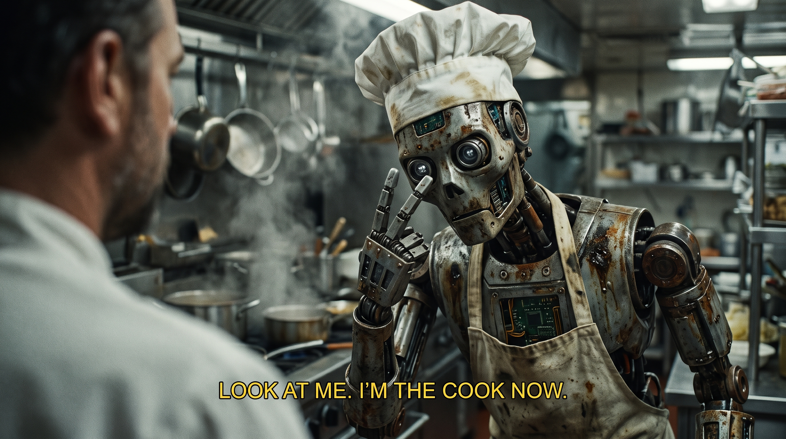

Conferences are good for tracking vendor roadmaps and better for checking keynote slides against operational reality (which tends to arrive late and uninvited). After spending the day comparing architectures, sitting through technical sessions, and trading notes in the hallways, one pattern kept coming back.

## Everyone Is Cooking the Same Soup

Software delivery across enterprise organizations looks a lot like a crowded kitchen where dozens of engineering teams are independently trying to cook the exact same pot of soup.

By now most of us agree on what belongs on the table. Its so familiar that nobody bothers to read them aloud, yet plenty of organizations have not put even half of it in place. Others skip the standard way and build a proprietary platform from scratch, convinced that one more bespoke orchestration layer will finally put developers in flow. And even with the basics on the stove, the way every decent chicken soup begins, is it enough to beat instant ramen?   

I saw at least four presentations by good and inspiring speakers, all telling how much fun it was to cook things on their own. Every demo was a toy, a game-like greenfield project, and the agents built it alone, so it looked like magic (it did to me too, in the beginning). Now take the same thing into a real company, where nobody tolerates a mistake, and the first day of the new platform gets the same verdict from the whole floor. *"This doesn't taste right."*

I believe there are two reasons for that. The first is that we keep serving grandma's dish, the old Agile manifesto of people and interactions over tools and processes, in a kitchen where the role of blender and human suddenly got reversed.

So most setups copy the human process onto the agents, with roles, a scrum master and a jira board (sic!) to report to. That is eating soup with a fork. Maybe the recipe is fine and we just need new cutlery, and [Anthropic's approach to SDLC](https://claude.com/resources/articles/the-ai-native-sdlc-playbook), maybe combined with openspec which i'm big fan of this week, surely looks like one.

The other one is information and memory management, and the consensus is there its the absolute necessity to have. Very refreshing presentation from Vitaliy who touched on multiple subjects, all circling around Information Management and agent context. I do believe it is important, because:

> Agentic memory is the chicken in this soup. Take it out and what remains is hot water with good intentions, however many pipelines you simmer around it.

The problem sits deeper than any single toolchain. The SDLC is one massive state management problem (tickets, Git history, architecture decisions, CI telemetry), and every new agent session starts with none of it.

To work safely inside an enterprise pipeline, an agent has to reason over a sprawling state machine that no prompt will hold, and stuffing in more tokens doesn't fix that.

Serious engineering around token economics and structured memory was present only in homeopathic doses at the conference. Vitalii Ratushnyi's session on agentic memory was a rare, welcome exception that treated context as a first-class systems problem:

The 'not quite' is where the talk lives. RAM reads the same at every address, while the middle of a window degrades. By his own evals, recall stops improving around 400k tokens while the bill keeps climbing, so a million-token window is a brochure number. A disk pages in by itself, while nothing here does until you write the retrieval. A model that wakes up on Tuesday with no idea what we decided on Monday is short on disk, whatever its IQ.

The Prime Agent paper puts numbers on the idea. On ARC-AGI-3, the same model scores 30.2% in the ARC harness and 95.5% in Prime Agent, which keeps its state on disk (the human baseline is 95.4%). Those are the authors' own figures for the whole harness, so I read them as same weights, different harness, and not as a memory benchmark.

Everyone brings a soup to the demo. Almost nobody brings the chicken.

## References

- Slide deck, "Agent memory in a nutshell: do's and don'ts" (Lisbon AI 2026): [vitalii.connectingdots.fyi/memory](https://vitalii.connectingdots.fyi/memory)
- Init command gist: [gist.github.com/MisreadableMind/e0e0e4cf](https://gist.github.com/MisreadableMind/e0e0e4cf) (also on slide 08)
- Handoff definition, dictionary of AI coding: [github.com/mattpocock/dictionary-of-ai-coding](https://github.com/mattpocock/dictionary-of-ai-coding)
- GitHub: [github.com/MisreadableMind](https://github.com/MisreadableMind)
- LinkedIn: [linkedin.com/in/v-ratyshnyi](https://linkedin.com/in/v-ratyshnyi)
- Benchmark: ContextArena, MRCR 8-needle leaderboard, [contextarena.ai](https://contextarena.ai)
- Paper: Prime Agent, [arxiv.org/abs/2608.23552](https://arxiv.org/abs/2608.23552)
- System architecture: typesafe.ai, System One models and Jev
- Harmix post on memory layers: [manager.harmix.ai/blog/spent-3000-on-memories](https://manager.harmix.ai/blog/spent-3000-on-memories)
- Video breakdown of Prime Agent: [youtube.com/watch?v=RbglwViPqcY](https://youtube.com/watch?v=RbglwViPqcY)
- Presenter: Vitalii Ratushnyi, Lead Research Engineer, Harmix.ai
